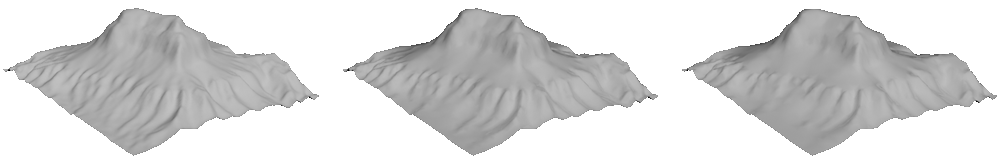

[](https://pypi.python.org/pypi/rqtreemesh/)

<p align="center">
	  
      <br />
	  <i>Triangulated terrain near Horseshoe Bend, Arizona.</i>
</p>

# rqtreemesh
**rqtreemesh** is a basic implementation of restricted quadtree triangulation (RQT), for converting raster heightmaps to 3D meshes. For an overview of RQT-based mesh generation, see
>Pajarola, Renato. "Overview of Quadtree-based Terrain Triangulation and Visualization." (2002).

Implemented in C++ with a pybind11 wrapper for Python.

## Quick Start

`git clone --recursive` this repo and run `pip install .` on it.

Alternatively:

`pip install rqtreemesh`.

This package requires `Numpy` and `Pillow`.

### Usage
Functionality is provided by the `Heightmap` class. 
```python
from rqtreemesh import Heightmap
```

Two constructors are available:
```python
heightmap = Heightmap(array: np.ndarray, pixel_dim: float, top_left_x: float, top_left_y: float)
```
**Parameters**

 ```python
 array: np.ndarray
 ```
 > Input raster heightmap as a 2-dimensional numpy array where each dimension is a power of two. E.g. 1024 x 2048. Maximum size is 32768 x 32768.
 
```python
 pixel_dim: float
 ```
 > The spatial dimension of one pixel in the input heightmap.
 
 ```python
 top_left_x:  float, top_left_y:  float
 ```
 > The x and y locations of the top left corner of the input heightmap. Note that this location is not the center of the top left pixel, but rather its top left corner.
***

Alternatively: 
```python
heightmap = Heightmap.from_geotiff(path: str)
```
**Parameters**

 ```python
 path: str
 ```
 > Path to input raster heightmap in geoTIFF format with dimesnsions a power of two. E.g. 1024 x 2048. Maximum size is 32768 x 32768. The geolocation and spatial resolution of the heightmap will be obtained from the appropriate tags in the geoTIFF.
***
Note that **rqtreemesh** was developed for converting Digital Elevation Models (DEMs) . For other heightmaps, such as where all values are between $0$ and $1$, scaling the `Heightmap.array` or `Heightmap.pixel_dim` may be necessary to obtain the desired result. Also take care when converting a DEM with planar units not equal to its elevation units (e.g. Geographic/WGS84 projection).
***
To generate a mesh, use the `generate_mesh` method.
```python
heightmap = Heightmap...
(vertices, triangles) = heightmap.generate_mesh(max_error: float, show_progress: bool = False) -> Tuple[np.ndarray, np.ndarray]
```
**Parameters**
```python
max_error: float
```
> The maximum absolute vertical distance between the input heightmap and the resulting mesh.

```python
show_progress: bool = False
```
> Show a progress bar while generating the mesh. Default value: False.

**Returns**
```python
(vertices, triangles): Tuple[np.ndarray, np.ndarray]
```
>A tuple containing the output mesh. `vertices` is an array where each row contains the x, y and z coordinates of a vertex. `triangles` is a connectivity matrix, i.e. an array where each row contains a triangle as three (zero-indexed) indices into the first element.
***
To provide easy compatibility with most 3D software, basic exporters to the Wavefront Object (.obj) and Stereolithography (.stl) formats are provided:
```python
from rqtreemesh import write_obj, write_stl
write_obj(path: str, verts: np.ndarray, triangles: np.ndarray, flip_zy: bool = False)
write_stl(path: str, verts: np.ndarray, triangles: np.ndarray)
```
**Parameters**
```python
path: str
```
>The output file path.
```python
verts: np.ndarray, triangles: np.ndarray
```
> A coordinate array and connectivity matrix, such as the output of `generate_mesh`.
```python
flip_zy: bool = True
```
>Interchange the z and y axes of the exported mesh (only for .obj export). Default value: False.
***
<center>
	<figure>
	  
	  <figcaption><i>Triangulation of a 2 meter per pixel resolution heightmap of East Pawnee Butte, Colorado. A maximum error of 0 meters results in a mesh consisting of 32768 triangles (left). A maximum error of 0.5 meters produces 8156 triangles (middle), and a  maximum error of 1 meter produces 4074 triangles (right). </i></figcaption>
	</figure>
</center>